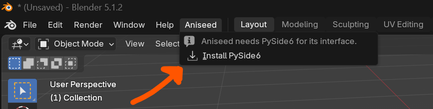
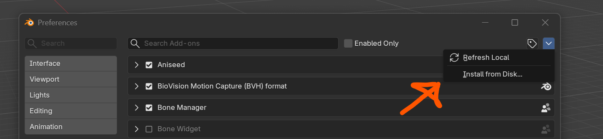
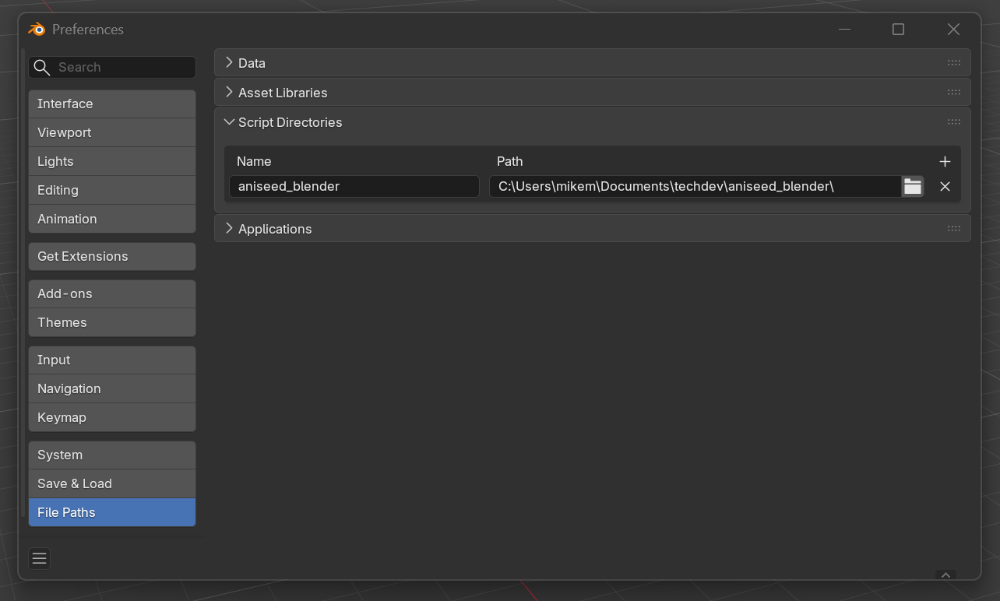
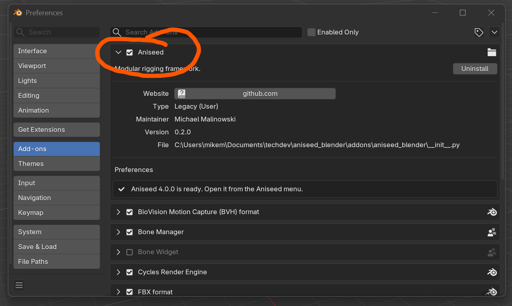
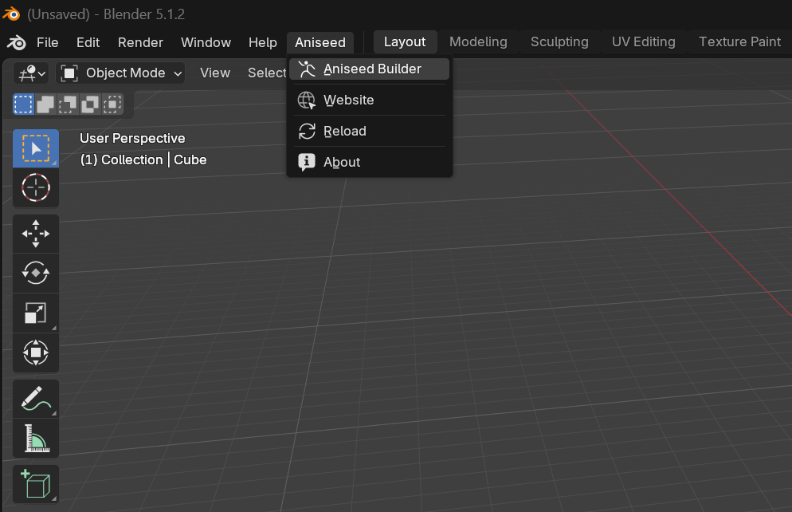
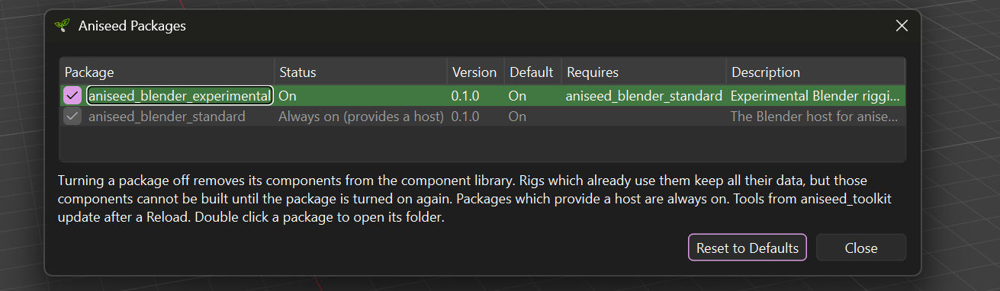

# Aniseed (Blender)

Aniseed is a **Modular Rigging Framework** which allows technical artists to develop
rigging components and construct rigs of any form.

The core of Aniseed is application agnostic and already has a Maya implementation which 
is actively used in production.

This repository is the home of the Blender implementation: a Blender add-on with
everything Aniseed needs bundled inside it, the Blender host, and a package of
rigging components (root, spine, neck and head, arms, legs and single controls).


**__Note: This is absolutely not production ready!__** It is an experimental addon to see 
how the Aniseed Rigging methodology maps to into the Blender Armature structure.


# General Premise

As with most modular rigging frameworks, Aniseed is made up of components. Each 
component very specifically has no knowledge of any other components. Instead a 
component exposes inputs (typically objects it requires) as well as options (typically
variables allowing you to tailor how a component builds). Finally a component can also
expose outputs - these are objects it guarantee's will exist once its built - allowing 
other components to utilise them. 

By taking this approach a component can be incredibly flexible in what it does. For 
instance a component could be an incredibly complex spline spine and create all sorts
of controls. Equally a component could just apply some metadata to objects or log 
information. 

Fundamentally there is no preconception of what a component should be used for, and it
is this flexibility which makes Aniseed a powerful rigging tool as it removes the need
for awkward post-rig scripts - everything is just a component in a stack. 

Finally there is the concept of "Execution Blocks" in the stack. So it is quite typical
to have an execution block for making the rig editable - which in the case of blender 
would likely remove the control rig and leave the deformation rig, whilst the "Build 
Rig" execution block will construct the control rig armature over the top of the 
deformation rig. 

# Requirements

* **Blender 4.2 or later.** Tested with Blender 4.2.1 LTS (which uses PySide6 6.9.1)
  and 5.1.2 (PySide6 6.12.0).
* **Windows.** qshake only supports parenting windows to Blender on Windows at the
  moment.
* **An internet connection the first time**, to download PySide6.

## PySide6

Aniseed's interface is built with Qt, through PySide6. PySide6 is not bundled, and 
each Blender version needs its own build. The first time the
add-on is enabled it offers to download the right build, using qshake. It is downloaded in
`vendor/qshake/_vendor/<platform>/<blender version>`, within the addon.

Simply click "Install PySide6" through the Aniseed Menu and it will download it into
the Aniseed directory for you.



If you prefer to download it yourself you absolutely can, just place it in the folder
outlined above.


# Installing

2. **Install the add-on**, in one of these ways:

   * **From a zip.**  
    From within the Add-ons panel in the Preferences you can point it
     to the aniseed_blender.zip in the dist folder

   
   * **As a script directory.**  
     In **Edit > Preferences > File Paths > Script Directories**, add the root of this
     repository (`C:\path\to\aniseed_blender`), then restart Blender. Blender looks for
     add-ons in the `addons` folder of each script directory.


     

3. **Enable the add-on.** In **Edit > Preferences > Add-ons**, search for **Aniseed** and
   tick it. An **Aniseed** menu appears in the top bar, after Help.


# Running it

## Opening the app

Choose **Aniseed > Aniseed Builder** from the top bar.


If this is your first go with Aniseed then it is highly recommended that you    
create a blank Blender scene and open this rig file: 
* `aniseed_blender\addons\aniseed_blender\packages\aniseed_blender_experimental\recipes\biped.json`

That is a great way to see something quickly and get a feel for what a rig stack usually
looks like.

# Turning packages on and off

**Edit > Packages...** in the app lists every aniseed package, with a check box to turn
each one on or off. Changes take effect straight away and are remembered.



Both bundled packages are on by default. `aniseed_blender_standard` provides the Blender
host, so it is always on.

A package can choose whether it starts on or off with `"enabled_by_default"` in its
`aniseed_package.json` (see [Writing your own components](#writing-your-own-components)).

## Building your first rig

1. Choose **Rigs > New Rig**, give it a name, and choose
   **Rig Configuration : Experiment** as the configuration. The rig gets the **Make Rig
   Editable** and **Build Rig** blocks and an empty deform armature.
2. Add components beneath **Build Rig > Components**: **Root**, then **IKFK Spine**
   beneath it, then **Neck And Head**, **Arm** and **Leg** beneath the spine. Each
   creates its bones as it is added.
3. Right click the Arm and the Leg and choose **Mirror** for the other side.
4. Press **Build Rig** at the bottom of the app, and animate the control armature.
5. **Ctrl+Z** undoes the whole build in one step.

The package's [README](addons/aniseed_blender/packages/aniseed_blender_experimental/README.md)
covers fitting the bones, the spine guide and storing control shapes.

## Trying the biped

Start a new file (**File > New > General**), open the app, and use its **File** menu to
open `addons/aniseed_blender/packages/aniseed_blender_experimental/recipes/biped.json`
(or the same file inside Blender's add-ons folder, if you installed from a zip). The
skeleton is recreated and the components loaded. Press **Build Rig**.

## Building without the user interface

Rigs can be built in background Blender, for example in a pipeline. The add-on is not
enabled in the background, so load aniseed through it directly:

```python
import sys
sys.path.insert(0, r"C:\path\to\aniseed_blender\addons")   # the folder containing the add-on

import aniseed_blender
aniseed_blender.install_pyside()   # downloads PySide6 the first time, otherwise does nothing
aniseed_blender.initialise()

import aniseed

# -- Turn on any packages the rig needs which might be off. persist=False only
# -- affects this session, leaving the user's own choices alone.
aniseed.packages.set_enabled("aniseed_blender_experimental", True, persist=False)

rig = aniseed.Rig.open(r"C:\path\to\recipe.json")
rig.build(build_below=rig.get_component_by_label("Build Rig"))
```

Run it with:

```
blender --background --factory-startup --python build_my_rig.py
```

`addons/aniseed_blender/packages/aniseed_blender_experimental/recipes/generate_biped.py`
is a complete example, and is also how the biped recipe is rebuilt after changing the
components:

```
blender --background --factory-startup --python addons/aniseed_blender/packages/aniseed_blender_experimental/recipes/generate_biped.py
```


# Writing your own components

Components go in an aniseed package: any folder containing an `aniseed_package.json`
file. Its `aniseed_package.json` describes it:

```json
{
    "version": "1.0.0",
    "description": "What the package is for",
    "hosts": ["blender"],
    "requires": ["aniseed_blender_standard"],
    "enabled_by_default": true
}
```

* `hosts`: the applications the package is for. If empty, it is used in all of them.
* `requires`: other packages it needs. Turning the package on in **Edit > Packages...**
  turns these on too, and the package is treated as off while any of them is off.
* `enabled_by_default`: whether the package is on until the user chooses otherwise.
  Defaults to `true`.

Put the package in the add-on's `packages` folder, or add the folder containing it to the
`ANISEED_PACKAGE_PATHS` environment variable (separated by `;`) before starting Blender.
Component files go in its `components` folder, and any code shared between them goes in
its `mixins` or `widgets` folders.

`packages/aniseed_blender_experimental` is a working example: start with
`components/basic/singular.py` (one bone and one control) and the `base.py` it builds on.
A few Blender specifics catch everyone:

* **Store names, never Blender objects.** Undo, redo and opening a file replace all of
  Blender's data, so any python reference to an object or bone stops being valid.
* **`mode_set` needs the object to be active.** A context override alone is not enough.
* **Edit bones only exist in edit mode.** Read their names before leaving it.
* **No full stops in component labels or identifiers.** The addresses which wire
  components together are split on them.
* **Component file names must start with a letter**, or they are silently skipped.

# What's in this repository

The whole of Aniseed for Blender is the one add-on folder, `addons/aniseed_blender`:

```
aniseed_blender/
    build_zip.py                             <- builds dist/aniseed_blender.zip
    dist/
        aniseed_blender.zip                  <- the add-on, ready to install from disk
    addons/
        aniseed_blender/                     <- the add-on: zip or link this folder
            __init__.py                      <- loads aniseed into Blender
            vendor/                          <- aniseed and everything it depends on
                aniseed/
                xstack/  crosswalk/  qtility/  factories/  signalling/  scribble/
                qshake/                      <- runs Qt in Blender (with Qt.py and blackout)
            packages/
                aniseed_blender_standard/    <- the Blender host
                aniseed_blender_experimental/ <- rigging components, and a biped recipe
```

* **`__init__.py`**: the add-on. It puts the bundled `vendor` folder on the path, tells
  aniseed where the bundled `packages` are, and starts aniseed's Blender host.
* **`vendor`**: copies of aniseed and the modules it needs: xstack, crosswalk, qtility,
  factories, signalling, scribble and qshake. Nothing else needs downloading or
  installing, apart from PySide6 (see below). `vendor/README.md` lists where each copy
  came from.
* **`packages/aniseed_blender_standard`**: the Blender host. It:
    * adds an **Aniseed** menu to Blender's top bar
    * opens the aniseed app as a Qt window parented to Blender, through qshake, centred
      over Blender the first time it opens
    * runs every build with a full Blender context, as one undo step, and puts the
      user's selection and active object back afterwards
    * keeps aniseed's rigs valid when the user saves, opens files, undoes or redoes
    * stores the rig's Empties and armatures (with their bones) in saved recipes, and
      recreates them when a recipe is loaded
* **`packages/aniseed_blender_experimental`**: rigging components which build a control
  armature driving the user's deform armature, with **Make Rig Editable** and **Build
  Rig** as in aniseed for Maya. See its
  [README](addons/aniseed_blender/packages/aniseed_blender_experimental/README.md).


# Updating the bundled modules

The modules in `addons/aniseed_blender/vendor` are plain copies of their own
repositories, updated by hand. To update one, replace its folder with a fresh copy
(leaving out `__pycache__` folders, and for qshake any `_vendor/<platform>` folders), then
update the table in `vendor/README.md`.


# Rebuilding the zip

`dist/aniseed_blender.zip` is committed, so people can install the add-on without
cloning or building anything. After changing the add-on, rebuild it with any Python 3
from the repository root, and commit it:

```
python build_zip.py
```

It zips `addons/aniseed_blender` (the zip holds the `aniseed_blender` folder itself),
leaving out Python caches and any downloaded PySide6 builds.


# Troubleshooting

* **The Experiment components (or Rig Configuration : Experiment) are missing.** The
  package has been turned off. Turn it on in **Edit > Packages...**.
* **Components show as missing placeholders after turning a package off.** That is
  expected: rigs keep the data of components from a package which is off, but cannot
  build them. Turn the package back on.
* **The Aniseed menu only shows "Install PySide6".** PySide6 has not been downloaded for
  this Blender version yet. Choose it (see step 4 of Installing).
* **Installing PySide6 fails.** Open **Window > Toggle System Console** for pip's output.
  The usual causes are no internet connection, or a firewall or proxy blocking pip.
* **There is no Aniseed menu at all.** Check the add-on is enabled, then look in the
  system console for messages starting with `Aniseed`.
* **"expected the blender host"** in the console means the bundled
  `aniseed_blender_standard` package was not found. Check that the add-on folder still
  contains its `packages` folder.
* **The menu entries appear twice, or the wrong app opens.** The old bqt-based add-on is
  still enabled. Disable and remove it (step 1 of Installing).
* **"Could not import or load ... __pycache__ ... .pyc" warnings** come from aniseed's
  component loader scanning Python's cache files. They are harmless, and stop once the
  `__pycache__` folders are deleted.
* **A component built fine in the past but now fails with
  `'NoneType' object has no attribute 'get'`.** An input is wired to a component whose
  label contains a full stop, or which has been renamed. Rename it back, or re-wire the
  input.
