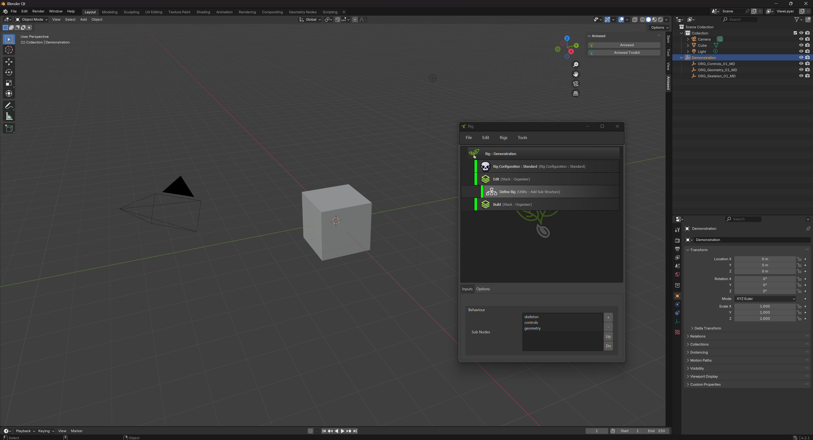

# Aniseed (Blender)

Aniseed is a **Modular Rigging Framework** which allows for technical artists to develop
rigging components and construct rigs of any form. 

The core of Aniseed is application agnostic, and so there is a well fleshed out 
version for maya which can be viewed here:

https://github.com/mikemalinowski/aniseed

However, this is going to be the home of the Blender implementation. The code is not
yet released, but locally we currently have it up and running in blender (using bqt)
and executing without issue. 

# Next Steps

It is now a case of fleshing Aniseed out with a series of components to start building
bipeds and quadrupeds. As we start to have a minimal set of components we'll do the 
first code release.
